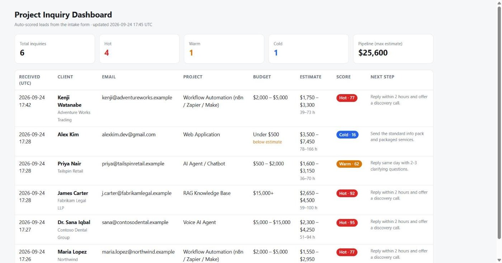
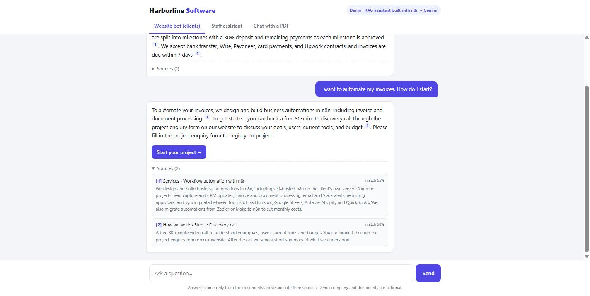
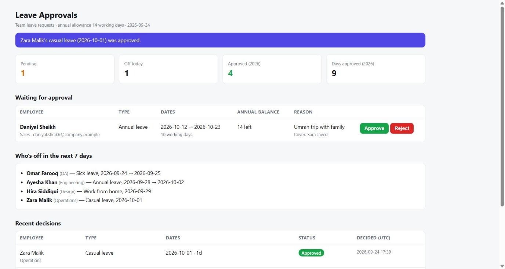
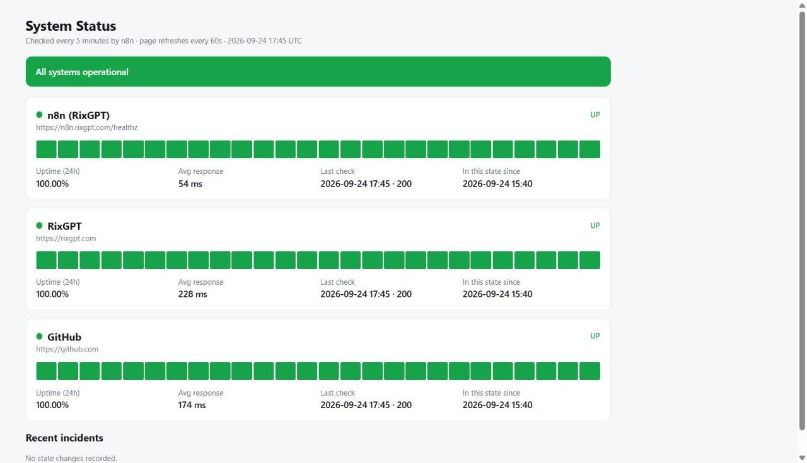

# n8n AI automation demos

Twelve working automations built on a self-hosted n8n server (DigitalOcean, Docker, PostgreSQL). Every workflow here runs live with sample data, so you can click the links and try them before reading the code.

| # | Workflow | Try it live | What it does |
|---|----------|-------------|--------------|
| 1 | [Client intake form with instant estimate & lead scoring](workflows/01-client-intake-instant-estimate.json) | https://n8n.rixgpt.com/form/project-inquiry | A prospect fills in a form and sees an estimated effort and price range right away. Each enquiry is scored 0-100 (hot / warm / cold) and shown on a private owner dashboard with a suggested next step. No paid APIs. |
| 2 | [RAG knowledge assistant with source citations (Google Gemini)](workflows/02-rag-knowledge-assistant-gemini.json) | https://n8n.rixgpt.com/webhook/rag-chat?kb=client (staff version: `?kb=staff`, upload your own PDF: https://n8n.rixgpt.com/form/rag-upload) | Documents are split into passages, embedded with `gemini-embedding-001` and searched by meaning. Answers cite the passages they came from and the bot says "I don't know" instead of guessing. Rate limits and follow-up questions included. |
| 3 | [Proposal & quote generator](workflows/03-proposal-quote-generator.json) | internal form (private) | An internal form turns a few choices (package, add-ons, discount, rush) into a printable proposal page with pricing, scope, payment terms and an expiry date. |
| 4 | [Team leave requests with manager approval](workflows/04-leave-requests-approvals.json) | https://n8n.rixgpt.com/form/leave-request | Employees request time off, n8n counts working days, checks the annual allowance and adds the request to an approvals page. The owner approves or rejects with one click and sees who is off in the next 7 days. |
| 5 | [Website uptime monitor & public status page](workflows/05-uptime-monitor-status-page.json) | https://n8n.rixgpt.com/webhook/status | Checks a list of sites every 5 minutes, keeps 24 hours of history and serves a public status page with uptime % and recent incidents. |
| 6 | [GitHub activity digest](workflows/06-github-activity-digest.json) | https://n8n.rixgpt.com/webhook/github-digest | A daily page with commits, pull requests and releases for the accounts and repos you watch, using the public GitHub API. |
| 7 | [Lead qualification → call booking → HubSpot CRM (Gemini, Google Calendar, Gmail)](workflows/07-lead-qualification-booking-hubspot.json) | https://n8n.rixgpt.com/webhook/book-a-call | A lead fills a short form; Gemini scores it 0-100 and writes a call agenda. The contact is created in HubSpot and logged in Google Sheets. Good fits pick a time from live Google Calendar free/busy; booking re-checks the slot, creates the event and a HubSpot deal, and sends a Gmail confirmation with an .ics invite. One reminder email after 45 minutes if no time is picked. |
| 8 | [AI invoice & receipt reader → Google Sheets with approval (Gemini)](workflows/08-invoice-receipt-reader-sheets.json) | https://n8n.rixgpt.com/webhook/invoices | Upload a PDF or a photo (or one of 3 sample PDFs the workflow generates itself). Gemini reads supplier, dates, PO, line items, tax and total with no templates; the workflow checks the maths, missing fields, duplicates and due dates, adds a row to Google Sheets, auto-approves clean invoices under 500 and gives bigger ones one-click approval that updates the status cell. |
| 9 | [AI inbox assistant: Gmail triage & drafted replies (Gemini, Gmail API, Google Sheets)](workflows/09-ai-inbox-assistant-gmail-triage.json) | https://n8n.rixgpt.com/webhook/inbox | Send a test email (or pick one of 6 samples) and it lands in a demo Gmail inbox. Gemini classifies it (lead / support / billing / meeting / newsletter / suspicious / other), sets priority and sentiment, writes a one-line summary and the next step. The workflow applies nested Gmail labels, stars and marks urgent mail important, archives newsletters and phishing, and for leads, support, billing and meetings saves a drafted reply inside the thread, never sent. Every email is logged to Google Sheets and a private owner view; the same chain sweeps real inbox mail every 10 minutes. |
| 10 | [AI lead finder: Google Maps → scored leads → Google Sheets + CSV (SerpAPI, Gemini)](workflows/10-ai-lead-finder-google-maps-sheets.json) | https://n8n.rixgpt.com/webhook/leads | Type a business type, a place and what you sell. SerpAPI's Google Maps engine returns up to 20 listings (cached 7 days, capped at 10 live searches a day); n8n visits up to 12 websites in parallel and finds emails, booking tools, chat widgets, WhatsApp links and social profiles; Gemini scores every business 0–100 for the offer with a reason, best channel and an opening line. Sorted list → Google Sheets (Leads tab), CSV download and a private owner view with the usage counters. |
| 11 | [AI outbound email sequence: 3 personalised emails, stops on reply (Gemini, Gmail API, Google Sheets)](workflows/11-ai-outbound-sequence-reply-detection.json) | https://n8n.rixgpt.com/webhook/sequence | Enter a lead (name, company, what they do, a pain point) with your own address as the lead's email. Gemini writes a three-step sequence (intro, concrete example, polite break-up), Gmail sends step 1 straight away and the follow-ups 3 and 6 minutes later (days, in real life) inside the same thread with In-Reply-To headers. A one-minute schedule reads each due thread: a reply or a bounce stops the sequence and records why, otherwise the next step is sent; every email carries a stop link. Result page with the three emails and a timeline, Google Sheets log (Sequences tab) and a private owner view. Limits: 20 sequences a day, 3 per connection, one per address, hourly safety net. |
| 12 | [AI CV screener: PDFs → ranked shortlist → Google Sheets + CSV (Gemini reads the PDFs)](workflows/12-ai-cv-screener-ranked-shortlist.json) | https://n8n.rixgpt.com/webhook/screening | Paste a job description and upload up to 5 CVs as PDF, or run the sample set (six fictional candidates the workflow writes as PDFs itself). Gemini first turns the job text into must-haves and nice-to-haves, then reads every PDF directly (no OCR) and returns a score, verdict, per-requirement status with evidence, years of relevant experience, strengths, gaps, red flags, a two-line summary and three interview questions. Candidates are ranked, written to Google Sheets (Screening tab) and offered as a CSV; a private owner view lists the last 7 days. Files are read once and never stored. |

## How to use these workflows

1. In your n8n instance open **Workflows → Import from file** and pick one of the JSON files in `workflows/`.
2. Private pages (owner dashboard, approvals page, proposal builder, re-index URL) use webhook paths ending in `CHANGE-ME-1` … `CHANGE-ME-4`. Replace them with your own random strings so nobody can guess the URLs.
3. Workflow 2 needs a Google Gemini API credential (the free tier is enough): open the four Gemini nodes and select your credential. Then open the re-index URL once to build the vectors.
3. Workflow 7 needs Google Gemini, Google Calendar, Google Sheets, Gmail and HubSpot (service key / private app token) credentials. Replace `YOUR_CALENDAR_ID`, `YOUR_SHEET_ID` (with a "Booking log" tab), `YOUR_HUBSPOT_PORTAL_ID`, `you@yourdomain.com` and `booking/owner-CHANGE-ME` in the Code and HTTP nodes.
3. Workflow 8 needs Google Gemini and Google Sheets credentials and a sheet with an "Invoices" tab (14 columns, see the Code nodes). Replace `YOUR_SHEET_ID` and `invoices/owner-CHANGE-ME`. Successful executions are not saved, so uploaded files never sit in the execution log.
3. Workflow 9 needs Google Gemini, Gmail (OAuth2, with the `gmail.modify` and `gmail.compose` scopes) and Google Sheets credentials, a sheet with an "Inbox triage" tab (12 columns, see the Code nodes) and nine Gmail labels (AI triage/Lead, Support, Billing, Meeting, Newsletter, Suspicious, Other, Urgent and Triaged). Replace `YOUR_SHEET_ID`, `your-inbox@gmail.com`, `inbox/owner-CHANGE-ME` and the `LABEL_ID_*` placeholders with the label ids from the Gmail API (`GET users/me/labels`). Drafts are created with the Gmail API and never sent.
3. Workflow 10 needs Google Gemini, Google Sheets and a SerpAPI credential (n8n's built-in "SerpAPI" credential type; the free plan has 250 searches a month) and a sheet with a "Leads" tab (19 columns, see the Code nodes). Replace `YOUR_SHEET_ID` and `leads/owner-CHANGE-ME`. The Code node sandbox has no `URL` class, so hostnames are parsed with a regex.
3. Workflow 11 needs Google Gemini, Gmail (OAuth2 with the `gmail.send` and `gmail.readonly` scopes) and Google Sheets credentials and a sheet with a "Sequences" tab (8 columns, see the Code nodes). Replace `YOUR_SHEET_ID`, `your-inbox@gmail.com` (the sending address, used in the From header) and `sequence/owner-CHANGE-ME`. The Schedule Trigger runs every minute; the demo waits 3 minutes between steps, change the `3 * 60000` gap in the "Record step 1" and "Record follow-up" Code nodes to days for real use.
3. Workflow 12 needs Google Gemini and Google Sheets credentials and a sheet with a "Screening" tab (18 columns, see the Code nodes). Replace `YOUR_SHEET_ID` and `screening/owner-CHANGE-ME`. The webhook accepts multipart uploads; PDFs are passed to Gemini as inline base64 (max 4 MB each) and successful executions are not saved, so CVs never sit in the execution log.
4. Workflow 1, 3, 4 and 5 use no external APIs at all. Data is kept in the workflow's static data, which is fine for demos and small teams; for larger volumes point the Code nodes at PostgreSQL (or pgvector / Qdrant for the RAG workflow).
5. Activate the workflow. Form URLs are `/form/<path>`, pages and APIs are `/webhook/<path>`.

Tested on n8n 2.35 with the Code, Form Trigger, Webhook, Respond to Webhook, Schedule Trigger, HTTP Request, Extract from File and LangChain (Gemini) nodes.

## Notes

- All names, documents and numbers in the demos are fictional ("Harborline Software", "Northwind", etc.).
- The workflows are kept deliberately small so they are easy to read: one Code node per step, comments at the top of each node, and a sticky note in each workflow that explains the flow.
- Built and maintained by Aqib ur Rehman — AI agent and n8n automation developer. Upwork profile: https://www.upwork.com/freelancers/aqibrehman

## License

MIT — use them in your own projects.
